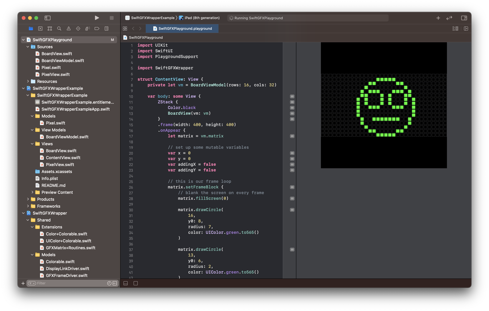

# SwiftGFXWrapper

## What is this?

This is a Swift -> Objective C -> C / C++ wrapper around the [Adafruit GFX library](https://github.com/adafruit/Adafruit-GFX-Library) meant to be ran in an iOS / macOS / watchOS environment.

## Why would you use it?

- Prototyping for a device that runs the Adafruit GFX library (e.g. a NeoMatrix)
- Generating the pixel buffer for a device that you want to push to
- [Playing with pixel graphics](https://github.com/twstokes/flipdots-ios) in an iOS / macOS / watchOS environment

## Getting started

### Initialize Git submodules
Install the Adafruit GFX library by running: `git submodule update --init`

A Swift Playground and an example project are included in this library to get started. SwiftUI is optional. Anything that can observe changes to pixels will work. `GFXMatrix` can be subclassed to fit your needs.

## Basic Usage

After initializing a `GFXMatrix`, you should be able to use it similarly to the Adafruit GFX library. The most important pieces are:

- `.setDrawCallback` - this is the closure that's called for every pixel being drawn
- `.setFrameBlock` - this is the closure that's ran on every "step" (equivalent to the `loop()` Arduino function)
- `.rgbaFrame()` - an owned RGBA8888 snapshot of the buffered matrix, suitable for a `CGDataProvider`
- `.frameRevision()` - a revision for skipping snapshot/image creation when drawing has not changed the frame

For displaying complete frames, leave the draw callback unset. This avoids per-pixel Swift bridging and enables clipped bulk fills and fast lines. The example creates a single `CGImage` for each changed frame and displays it with nearest-neighbor scaling. Setting a draw callback retains the generic Adafruit traversal and changed-pixel notifications.

Snapshots use logical row-major coordinates with the current `width()` and `height()`, including rotation. RGB565 channels expand to full-range RGB888 and alpha is always 255. Old snapshots remain valid after subsequent drawing. Repeated snapshot requests reuse the owned data until drawing or rotation invalidates it. Bulk drawing conservatively advances the revision even if it writes the same colors. Use one thread for matrix drawing, callbacks, and snapshot access.

The graphics algorithms and fonts remain in the bundled Adafruit library; fast paths optimize buffer writes while retaining its clipping and line behavior.

The example code covers:

1. Setting up a pixel buffer
2. Initializing a matrix and setting the draw callback function
3. Initializing a driver to run the step function on the matrix
4. Calling a graphics routine that sets the frame block

## Supported platforms

- iOS 14.1+
- macOS 11+
- watchOS 7.2+

### Carthage installation

Add this to your Cartfile: `github "twstokes/swift-gfx-wrapper"`

`DisplayLinkDriver` defaults to native screen cadence. Bind it with `setWindowScene(_:)` to synchronize with the window's display, including external screens. `setFrameRate(fps: 0)` restores native cadence after an override. The example binds when its view joins a window and pauses when detached; its Info.plist enables frame rates above 60 Hz on supported iPhones. The delivered cadence remains controlled by iOS, including power and thermal limits. Frame blocks run once per display tick, so routines that move one pixel per step run faster on faster screens.

## Performance validation

Run `sh Tests/run-native-tests.sh` for a release-mode C++ compatibility suite and CPU benchmarks, or `SANITIZE=1 sh Tests/run-native-tests.sh` for address/undefined-behavior checks. The suite compares 12,000 operations against the bundled generic Adafruit primitives across all four rotations, including callback order, text, bitmaps, clipping, and RGBA conversion. Benchmarks use a 256×128 buffer and report drawing and conversion separately; they do not measure display/GPU latency. Swift snapshot ownership and caching tests are in the macOS test target.
